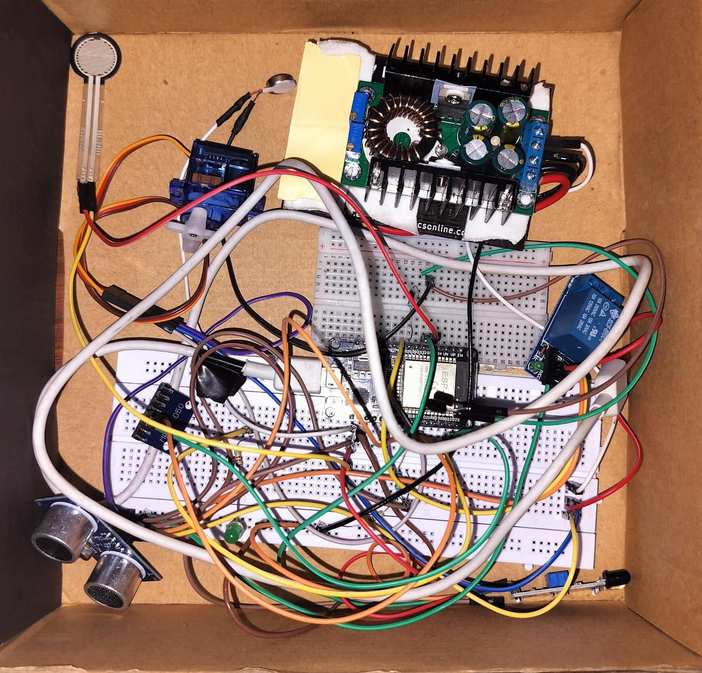
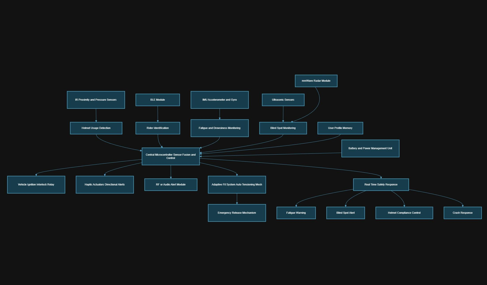
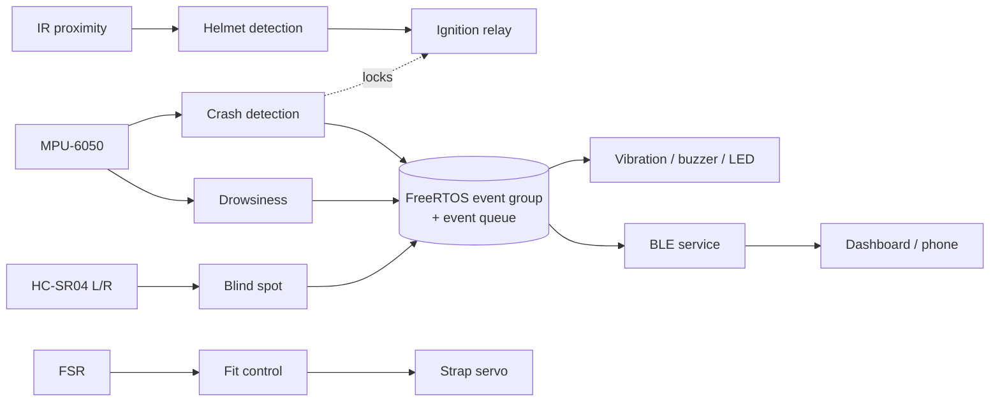
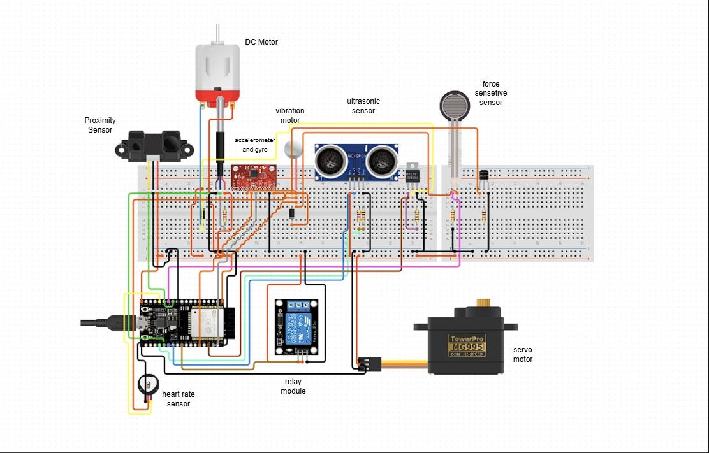
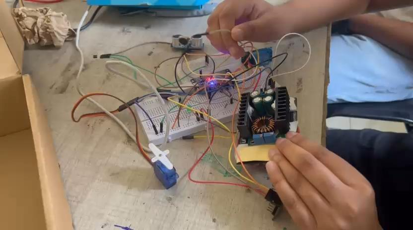
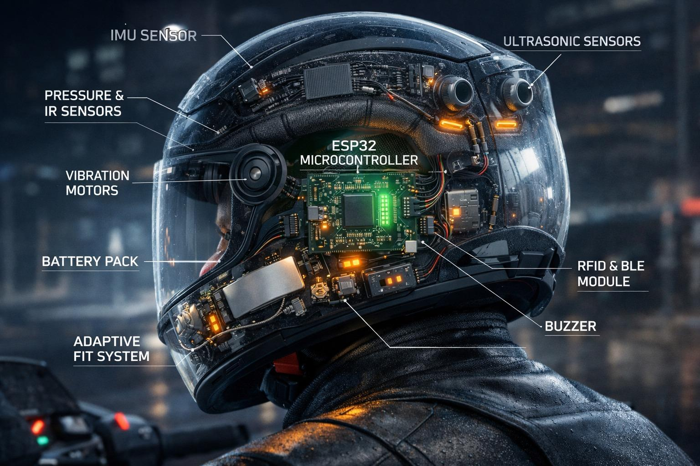
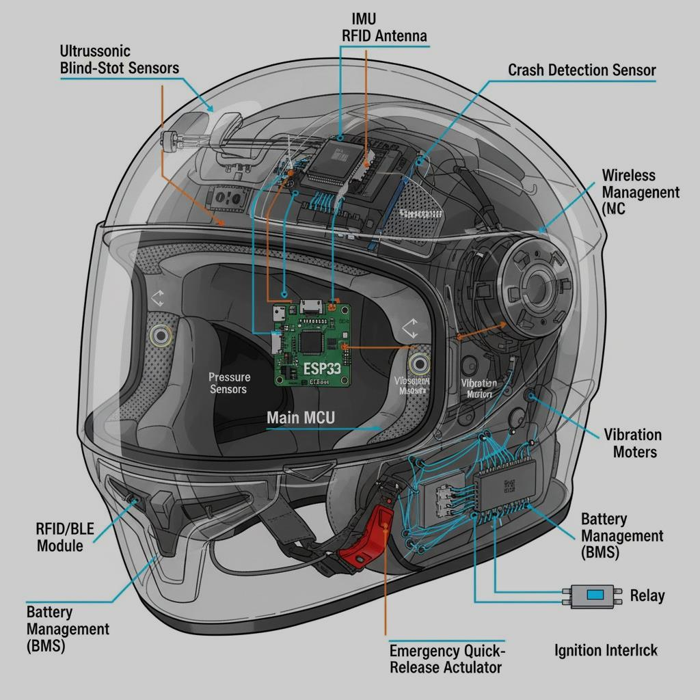

# Active-Safety Helmet for Rider Safety & Monitoring

**An ESP32 + FreeRTOS smart helmet that won't let the bike start unless it's worn, detects crashes and drowsiness, warns about vehicles in the blind spots, and adjusts its own strap tension.**

[](firmware/platformio.ini)
[](docs/hardware.md)
[](docs/architecture.md#freertos-task-model)
[](firmware/src/modules/ble_service.h)
[](LICENSE)


*Our working breadboard prototype: ESP32, MPU-6050 IMU, HC-SR04 ultrasonic sensor, IR proximity sensor, FSR, servo, ignition relay and buck converter.*

Embedded Systems course project, School of Computer Science and Engineering, VIT Vellore (Winter Semester 2025–26).

---

## Problem & objectives

A conventional helmet is passive: it only helps once a crash has already happened, and only if the rider chose to wear it. This project turns the helmet into an **active safety system** that watches both the environment and the rider:

1. **Monitor** environmental conditions (blind-spot traffic) and the rider's physiological state (head motion, fatigue, impacts).
2. **Enforce helmet use** with a fail-safe ignition lock: the vehicle runs only while the helmet is worn.
3. **Keep the fit right** with an automated system that adjusts internal strap tension in real time.

## Features

| Feature | Sensor → actuator | How it works |
|---------|-------------------|--------------|
| 🔒 **Helmet-wear ignition lock** | Sharp IR proximity → relay | Hysteresis + debounce. The relay is off at boot, and a 5 s grace period stops a sensor dropout from cutting the engine mid-ride |
| 💥 **Crash detection** | MPU-6050 → buzzer, vibration, BLE | 100 Hz sampling at ±16 g. An impact > 4 g is confirmed by a stillness check (> 8 g latches at once). The crash stays latched until acknowledged |
| 😴 **Drowsiness detection** | MPU-6050 → vibration + buzzer | Complementary-filter head pitch: repeated nods, head drop, plus the 6 s inactivity rule |
| 🚗 **Blind-spot warning** | 2× HC-SR04 → L/R vibration + LED | Interrupt-timed echoes, rolling median of 3, directional haptics at 10–70 cm |
| 🎯 **Auto-tension adaptive fit** | FSR 402 → servo | Hysteresis loop with hard angle limits. It holds position on a bad reading and releases after a crash |
| 📱 **BLE telemetry** | ESP32 NimBLE → phone/laptop | Status struct every 500 ms, alert notifications, remote crash-clear, and a Web Bluetooth dashboard |
| ⏱️ **FreeRTOS** | - | One task per safety function, priority-ordered: crash > ignition > blind spot > drowsiness > fit > BLE |
| ➕ *Optional* heart rate / DC motor | Pulse sensor, MOSFET motor | On the circuit diagram but not defined in the slides. Implemented as modules that are **off by default** |

## Architecture


*Detailed block diagram from the design stage. Blocks such as mmWave radar and rider identification are planned extensions (see [Future work](#future-work)).*



| Task | Priority | Period |
|------|----------|--------|
| IMU / crash | 6 | 10 ms |
| Alerts (actuator patterns) | 5 | 20 ms |
| Helmet + ignition | 5 | 200 ms |
| Blind spot | 4 | 150 ms |
| Drowsiness | 3 | 120 ms |
| Fit control | 2 | 250 ms |
| BLE | 1 | 500 ms + event-driven |

The full five-layer breakdown (sensing, processing, actuation, communication, system flow), the state machines and the module map are in **[docs/architecture.md](docs/architecture.md)**.

## Hardware

| Component | Qty | Purpose |
|-----------|-----|---------|
| ESP32 DevKit V1 | 1 | Controller with built-in BLE |
| Sharp GP2Y0A21 IR proximity sensor | 1 | Head-in-helmet detection |
| MPU-6050 (GY-521) | 1 | Crash + drowsiness (accel + gyro) |
| HC-SR04 ultrasonic | 2 | Left / right blind spot |
| FSR 402 or Velostat | 1 | Strap pressure |
| SG90 / MG90S / MG995 servo | 1 | Strap tension (PCA9685 if > 2 servos) |
| 5 V relay module | 1 | Ignition interlock |
| Coin vibration motors | 2 | Directional haptics |
| Active buzzer, LEDs | 1+ | Audible / visual alerts |
| Buck converter + 2S Li-ion | 1 | 5 V rail |

**Pin map** (integrated firmware, from [`config.h`](firmware/include/config.h)):

| Function | GPIO | | Function | GPIO |
|----------|------|-|----------|------|
| I²C SDA / SCL (MPU-6050) | 21 / 22 | | IR helmet sensor (ADC1) | 34 |
| Ultrasonic L TRIG / ECHO | 5 / 18 | | FSR (ADC1) | 35 |
| Ultrasonic R TRIG / ECHO | 19 / **23** | | Fit servo | 13 |
| Vibration L / R | 25 / 26 | | Ignition relay | 14 |
| Buzzer | 27 | | Warning LED / status LED | 4 / 2 |
| Crash-clear button (BOOT) | 0 | | *Opt.* heart rate / DC motor | 32 / 33 |

> **Changed from the slides:** the right ECHO moved from GPIO 21 to **GPIO 23**, because GPIO 21 is the MPU-6050's I²C SDA. All analog inputs are on ADC1, since ADC2 is unusable while BLE is on. The full BOM with justifications, wiring rules (5 V ECHO dividers, transistor drivers, separate servo supply), the GPIO 14 boot-glitch note and a power budget are in **[docs/hardware.md](docs/hardware.md)**.


*Breadboard wiring diagram (also shows the optional heart-rate sensor and DC motor).*


*Testing the prototype on the bench.*

## Concept illustrations

These are **concept illustrations**, not photos of our hardware. They show how the electronics could be packaged in a finished helmet.

| | |
|---|---|
|  |  |
| *Concept illustration: component placement* | *Concept illustration: labelled cut-away* |

## Getting started

### PlatformIO (recommended)

```bash
pip install platformio
cd firmware
pio run                  # build
pio run -t upload        # flash (hold BOOT if the upload doesn't start)
pio device monitor       # 115200 baud
```

`platformio.ini` pins the platform (`espressif32 @ 6.12.0`, Arduino-ESP32 2.0.17) and all libraries, so the build is reproducible.

### Arduino IDE

1. Install the **esp32** board package by Espressif (2.0.x) and select **ESP32 Dev Module**.
2. Install these libraries from the Library Manager:
   - **MPU6050** by Electronic Cats
   - **NimBLE-Arduino** by h2zero (2.x)
   - **ESP32Servo** by Kevin Harrington / madhephaestus
3. The [examples](examples) open directly. The integrated firmware is a PlatformIO project; to build it in the Arduino IDE, flatten it into one sketch folder:
   - create a folder `helmet/` and copy `src/main.cpp` into it as `helmet.ino`
   - copy `include/config.h`, `src/system_state.*` and every file in `src/modules/` into the same folder
   - in `helmet.ino`, change `#include "modules/xyz.h"` to `#include "xyz.h"`

### Feature flags

Edit [`firmware/include/config.h`](firmware/include/config.h):

```c
#define FEATURE_BLE          1
#define FEATURE_FIT_CONTROL  1
#define FEATURE_HEART_RATE   0   // optional, off by default
#define FEATURE_DC_MOTOR     0   // optional, off by default
#define DEBUG_CSV            1   // CSV stream for the plotter
```

### BLE dashboard

1. Flash the firmware. The helmet advertises as **`SmartHelmet`**.
2. Open [`tools/ble-dashboard/index.html`](tools/ble-dashboard/index.html) in **Chrome or Edge** (desktop or Android). Web Bluetooth isn't supported on iOS or Firefox.
3. Click **Connect** and pick `SmartHelmet`. You get live helmet/ignition status, left/right distances, head pitch, strap pressure, the active alerts, an event log, and a red **crash banner** with a *Clear* button.

The protocol (service/characteristic UUIDs and the 18-byte status layout) is documented in [`ble_service.h`](firmware/src/modules/ble_service.h), so the same data can be read with nRF Connect or a future Flutter app.

### Calibration

```bash
pip install pyserial matplotlib
python tools/serial_plotter.py --list-ports
python tools/serial_plotter.py --port COM5 --preset crash   # helmet | crash | drowsy | blind | fit
```

Every threshold in `config.h` is tagged with its origin (`[slide N]` or `[new]`). The step-by-step tuning procedure for each module is in **[docs/calibration.md](docs/calibration.md)**.

A latched crash is cleared by **holding BOOT for 3 s**, typing `clear` in the serial monitor, or pressing *Clear* in the dashboard.

## Repository structure

```
├── firmware/                  PlatformIO project: integrated FreeRTOS firmware
│   ├── platformio.ini
│   ├── include/config.h       all pins, thresholds, timings, feature flags
│   └── src/
│       ├── main.cpp           task creation and scheduling, console, event dispatch
│       ├── system_state.*     shared state, alert event group, event queue
│       └── modules/           helmet_detect, ignition_relay, imu_monitor, blind_spot,
│                              fit_control, alerts, ble_service, heart_rate*, dc_motor*
├── examples/                  the 5 original slide sketches, reproduced exactly
├── tools/
│   ├── ble-dashboard/         single-file Web Bluetooth dashboard
│   └── serial_plotter.py      live CSV plotter for threshold tuning
└── docs/
    ├── architecture.md        layers, task model, state machines (Mermaid)
    ├── hardware.md            BOM, pin map, wiring, power, changes from the slides
    ├── calibration.md         tuning procedure per module
    ├── presentation.pdf       final project presentation
    └── images/
```

## Project status

| Component | Status |
|-----------|--------|
| [01 Blind spot (single)](examples/01_blind_spot_single) | ✅ Tested on breadboard prototype |
| [02 Helmet detection + relay](examples/02_helmet_detect_relay) | ✅ Tested on breadboard prototype |
| [03 Crash detection](examples/03_crash_detection) | ✅ Tested on breadboard prototype |
| [04 Drowsiness detection](examples/04_drowsiness_detection) | ✅ Tested on breadboard prototype |
| [05 Blind spot (dual)](examples/05_blind_spot_dual) | ✅ Tested on breadboard prototype |
| Integrated FreeRTOS firmware | 🟡 Implemented, compiles cleanly; pending hardware validation |
| BLE service | 🟡 Implemented, pending hardware validation |
| Web Bluetooth dashboard | 🟡 Implemented, pending hardware validation |
| Adaptive fit (FSR + servo loop) | 🟡 Implemented, pending hardware validation |
| Heart rate / DC motor | ⚪ Optional modules, disabled by default |
| Mobile app, cloud logging, GPS SMS | ⚪ Future work |

## Feasibility challenges & risk mitigation

| Area | Feasibility | Main challenge | Mitigation in this repo |
|------|-------------|----------------|--------------------------|
| Helmet detection | High | IR false readings in bright light | Hysteresis band, debounce, calibration procedure |
| Drowsiness | Medium | Telling fatigue from normal head movement | Pitch relative to a slow posture baseline, minimum nod duration, nod count within a window |
| Accident detection | Medium | False alarms from bumps | Higher threshold, duration requirement, post-impact stillness check |
| Collision / blind spot | Medium | Rain, dust, traffic clutter | Median filter, min-distance cut-off; radar listed as future work |
| Adaptive fit | Feasible | Mechanical design and durability | Small steps, hard angle limits, hold on bad readings |

| Risk | Mitigation |
|------|-----------|
| Hardware (sensor error, servo or relay failure) | Calibration, fail-safe relay default (off), servo hard limits, fit-fault alert |
| Software (IMU false positives, memory, BLE drops) | Threshold tuning tools, all tasks and queues allocated once at boot (RAM 11.5 %), auto-restart of BLE advertising |
| Safety (distracting alerts, failure mid-ride) | Ignition grace period instead of an instant cut-off; short haptic patterns |
| Operational (battery life, wear) | Rechargeable pack, power budget in hardware.md |
| Regulatory (helmet certification) | Prototype only, with the disclaimer below |

## Future work

- **Mobile app** in Flutter (or React Native) on top of the documented BLE protocol: notifications, ride history, helmet-usage logs.
- **Firebase** logging and push notifications for remote monitoring and analytics.
- **GPS-based emergency SMS:** send the crash location to predefined contacts, through the phone app or a GSM module.
- **PCA9685 multi-servo** fit system to tension several mesh points.
- mmWave radar for more robust blind-spot detection in rain and dust, and RFID/BLE rider identification with stored user profiles (from the block diagram).
- A custom PCB and enclosure to replace the breadboard.

## Safety disclaimer

> ⚠️ **This is an academic prototype, not a certified helmet.** Modifying a helmet (drilling, embedding electronics, adding servos) can compromise its protective rating and legal compliance. Crash, drowsiness and blind-spot detection have **not** been validated and must not be relied on for safety.
>
> **Do not wire the ignition interlock into a real vehicle** without proper automotive-grade isolation, fusing, load-dump/transient protection and a manual override, installed by someone qualified. A failure of the controller, relay or sensor must never be able to stop an engine unexpectedly while riding.

## Team

| Name |
|------|
| Parizaa Munshi |
| Maan Hitesh Teckwani |
| Jothi Baskar |

**Course:** Embedded Systems, School of Computer Science and Engineering, Vellore Institute of Technology (VIT), Vellore. Winter Semester 2025–26.

The full presentation is in [docs/presentation.pdf](docs/presentation.pdf).

## License

[MIT](LICENSE) © 2026 Parizaa Munshi, Maan Hitesh Teckwani, Jothi Baskar
