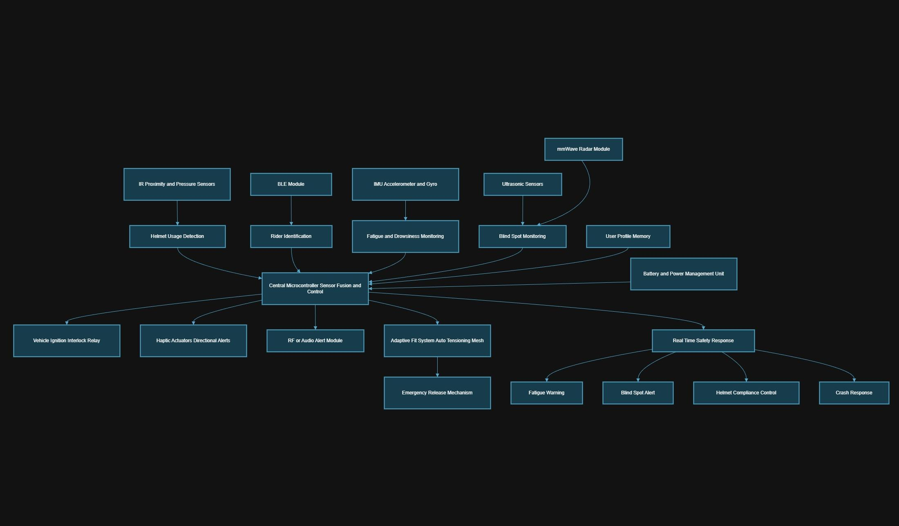
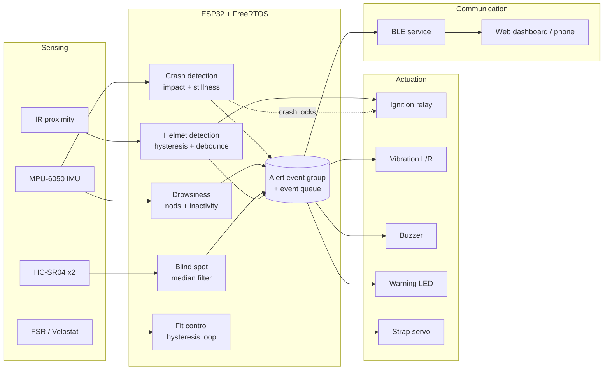
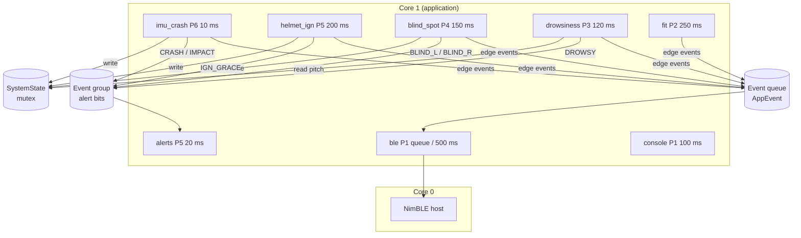
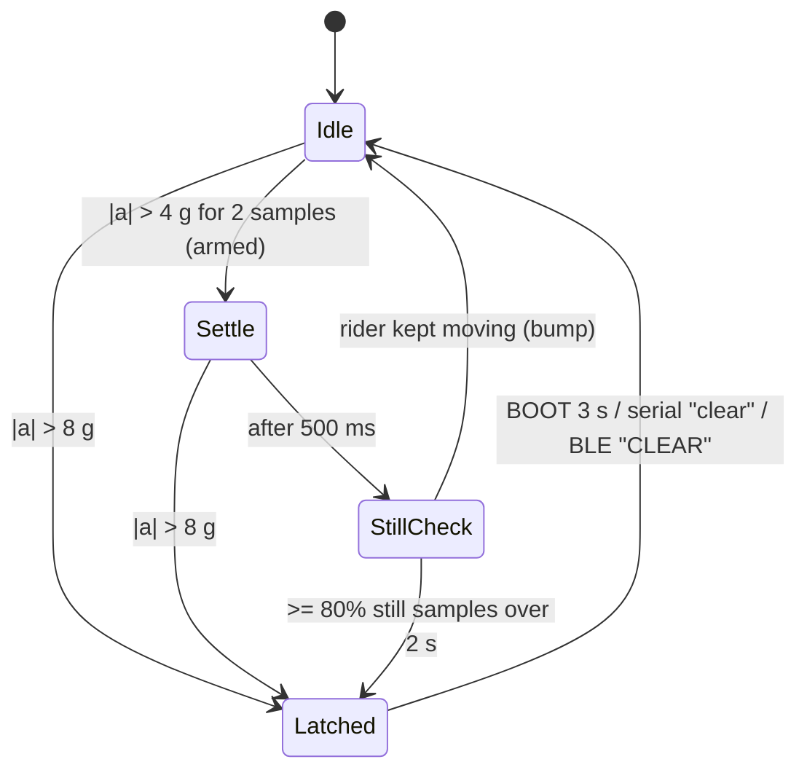
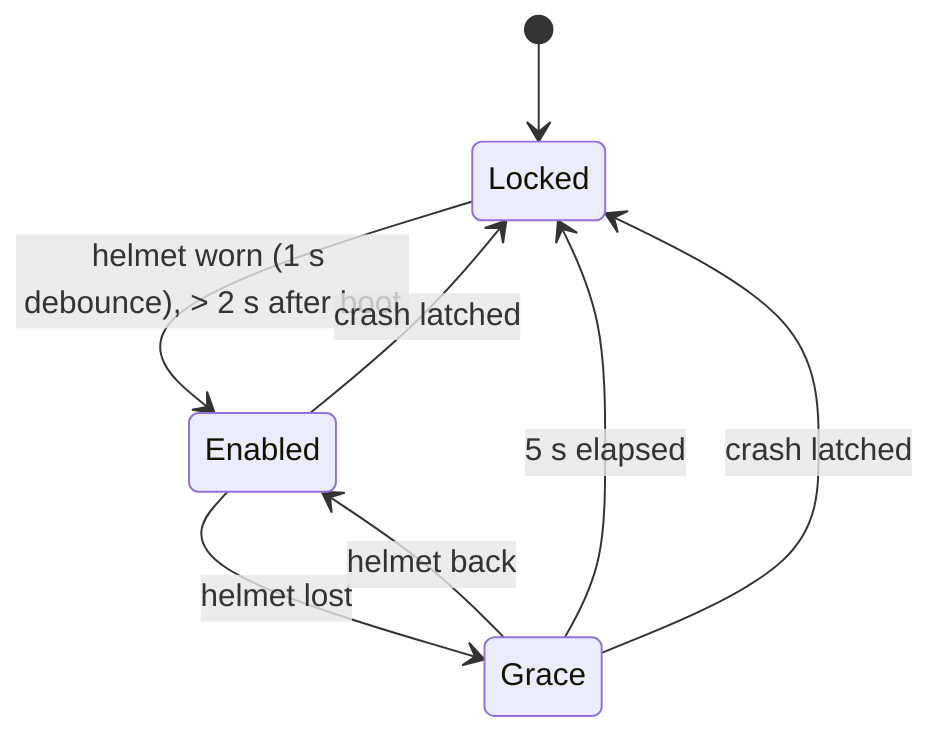

# Architecture

The system follows the five layers from the presentation: **sensing → processing → actuation & alerts → communication**, tied together by the overall system flow. On the firmware side, each safety function is a FreeRTOS task. Tasks share a mutex-protected state struct, an event group for continuous alert conditions, and a queue for one-shot events.

*Detailed block diagram from the presentation (slide 7). The mmWave radar, rider identification (RFID) and user-profile blocks are design-stage ideas that the current firmware doesn't implement (see [Future work](../README.md#future-work)).*

## 1. Sensing layer

| Function | Sensor | Signal |
|----------|--------|--------|
| Rider detection & helmet usage | Sharp IR proximity sensor | Analog, ADC1 (GPIO 34) |
| Motion & fatigue monitoring | MPU-6050 IMU (accelerometer + gyroscope) | I²C (GPIO 21/22), 100 Hz |
| Collision & blind-spot detection | 2× HC-SR04 ultrasonic (left/right) | TRIG + interrupt-timed ECHO |
| Helmet fit measurement | FSR 402 / Velostat | Analog, ADC1 (GPIO 35) |
| *Optional* heart rate | Analog pulse sensor | Analog, ADC1 (GPIO 32) |

## 2. Processing layer (ESP32 + FreeRTOS)

- **Acquisition:** each task samples its sensors at a fixed period with `vTaskDelayUntil()`.
- **Signal conditioning:** ADC averaging (IR, FSR), a rolling median (ultrasonic), unit conversion to g and °/s, and a complementary filter for head pitch.
- **Risk & event detection:**
  - Helmet off → debounced, hysteresis-filtered → ignition relay locked after a grace period
  - Drowsiness → repeated forward nods / head drop / inactivity → haptic + buzzer
  - Accident → impact > 4 g, then a stillness check (or > 8 g immediately) → latched crash response
  - Collision → object 10–70 cm in a blind spot → directional vibration + LED
- **Adaptive fit control:** hysteresis loop on FSR pressure → servo steps, with hard angle limits.

## 3. Actuation & alert layer

| Actuator | Driven by |
|----------|-----------|
| Ignition relay | `ignition_relay`: LOCKED / ENABLED / GRACE state machine |
| Vibration motors L/R | `alerts`: crash (both on), drowsy (both pulsing), blind spot (one side) |
| Buzzer | `alerts`: crash (4 Hz), drowsy (chirps), impact (1 Hz chirp), grace (chirp) |
| Warning LED | `alerts`: blind spot (steady), crash (blinking) |
| Fit servo | `fit_control`: tighten / loosen / hold; release on crash or helmet removal |

## 4. Communication layer

- **BLE (NimBLE):** one custom service with a STATUS characteristic (18-byte packed struct, notified every 500 ms), an ALERT characteristic (`"CRASH,1"`-style text, notified on every event) and a COMMAND characteristic (`"CLEAR"`). Advertising restarts on disconnect.
- **Web Bluetooth dashboard** ([`tools/ble-dashboard`](../tools/ble-dashboard/index.html)): live status, distances, alerts and a crash banner. It stands in for the planned Flutter app.
- **Serial:** CSV stream plus `# EVT` log lines, consumed by [`tools/serial_plotter.py`](../tools/serial_plotter.py).

## 5. Overall system flow

## FreeRTOS task model

| Task | Priority | Period | Source of timing |
|------|----------|--------|------------------|
| `imu_crash` | 6 | 10 ms | new (slide 24 used 80 ms) |
| `alerts` | 5 | 20 ms | new |
| `helmet_ign` | 5 | 200 ms | slide 23 |
| `blind_spot` | 4 | 150 ms | slides 22/26 |
| `drowsiness` | 3 | 120 ms | slide 25 |
| `fit` | 2 | 250 ms | new |
| `heart_rate` (optional) | 2 | 20 ms | new |
| `ble` | 1 | 500 ms + event-driven | new |
| `console` | 1 | 100 ms | new |

All application tasks are pinned to core 1; the NimBLE host stack runs on core 0. No task calls `delay()`.

## Crash detection state machine

While latched: buzzer at 4 Hz, both vibration motors on, warning LED blinking, `CRASH,1` sent over BLE, ignition locked, strap servo released.

## Ignition interlock state machine

## Module map

| File | Responsibility |
|------|----------------|
| `include/config.h` | Pins, thresholds, timings, priorities, feature flags |
| `src/main.cpp` | Task creation and scheduling, console, event dispatch |
| `src/system_state.*` | Shared state (mutex), alert event group, event queue |
| `src/modules/helmet_detect.*` | IR averaging, hysteresis, debounce |
| `src/modules/ignition_relay.*` | Fail-safe relay state machine |
| `src/modules/imu_monitor.*` | MPU-6050, complementary filter, crash + drowsiness |
| `src/modules/blind_spot.*` | Interrupt-timed HC-SR04, median filter |
| `src/modules/fit_control.*` | FSR → servo hysteresis loop |
| `src/modules/alerts.*` | Actuator patterns from alert bits |
| `src/modules/ble_service.*` | NimBLE GATT service |
| `src/modules/heart_rate.*` | Optional BPM measurement |
| `src/modules/dc_motor.*` | Optional PWM haptic motor |
