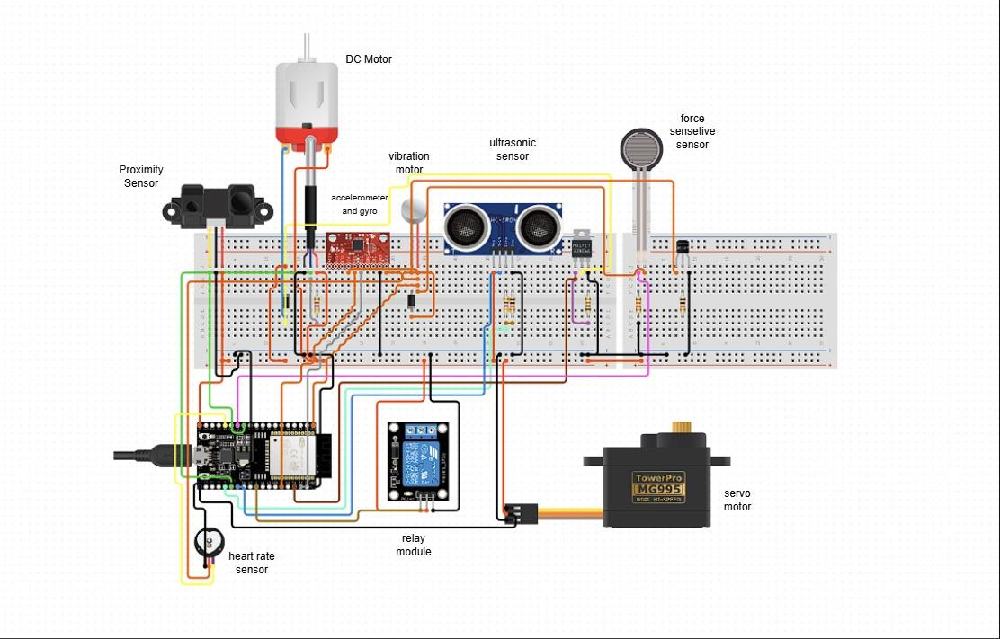
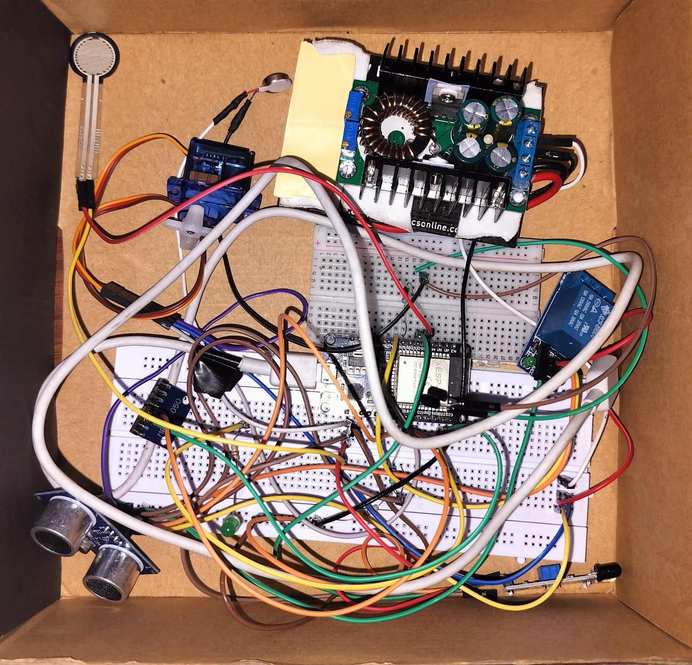
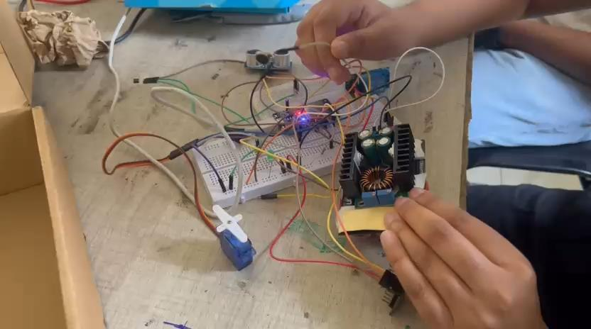

# Hardware

This page covers the bill of materials, the integrated pin map, wiring rules, power, and every change made to the pin assignments and logic of the original slide sketches.


*Breadboard wiring diagram from the presentation (slide 15).*

## Bill of materials

| # | Part | Qty | Role | Why this part (from the slides) |
|---|------|-----|------|---------------------------------|
| 1 | **ESP32 DevKit V1** (ESP32-WROOM-32) | 1 | Main controller | Built-in Wi-Fi + BLE (no separate Bluetooth module), many ADC and GPIO pins, enough CPU for real-time sensor fusion, low power, large library ecosystem. Runs FreeRTOS natively. |
| 2 | **Sharp GP2Y0A21YK0F** analog IR proximity sensor | 1 | Helmet-wear detection | Detects a head inside the shell; compact and low power; analog output goes straight to an ESP32 ADC pin. |
| 3 | **MPU-6050** (GY-521 breakout) | 1 | Crash + drowsiness | 3-axis accelerometer + gyroscope over I²C; tracks tilt, nodding and sudden impacts; small, cheap, well supported. The MPU-9250 adds a magnetometer if heading is ever needed. |
| 4 | **HC-SR04** ultrasonic sensor | 2 | Blind-spot detection (left/right) | Simple digital interface, affordable and widely used for proximity detection; can be mounted at the blind spots or on the rear. |
| 5 | **1-channel 5 V relay module** | 1 | Ignition interlock | Electrically isolates the ESP32 from the vehicle's ignition circuit; driven by one GPIO pin. |
| 6 | **Coin vibration motor** (10 mm, 3 V) | 2 | Haptic alerts (left/right) | Compact, low power, fits in the padding. Driven through a transistor. |
| 7 | **Active buzzer** (5 V) | 1 | Audible alerts | Crash and drowsiness alarm. |
| 8 | **LEDs** (red warning, plus the on-board status LED) + 330 Ω | 1+ | Visual alerts | Blind-spot and crash warning; low power. RGB optional. |
| 9 | **FSR 402** (Interlink) or a **Velostat** sheet | 1 | Strap-pressure feedback | Gives closed-loop feedback on strap tightness for the adaptive fit. |
| 10 | **Micro servo**: SG90 / MG90S (slides) or MG995 (circuit diagram) | 1 | Strap tensioning | Small and light enough to adjust the strap; the MG995 has more torque but draws much more current. |
| 11 | **Nylon thread / cable mesh** | - | Tension mesh | Light, strong, flexible support for adjustable tension. |
| 12 | **PCA9685** 16-ch PWM driver | 0–1 | Only with more than 2 servos | Controls many servos over I²C without using up the ESP32's PWM pins. |
| 13 | **NPN transistor** (2N2222 / S8050) or logic-level MOSFET (AO3400) | 2–3 | Motor / buzzer drivers | GPIO pins can't source motor current. |
| 14 | **Diode** 1N4148 / 1N5819 | 2–3 | Flyback protection | Across each motor and the relay coil (most relay modules include one). |
| 15 | **Resistors**: 1 kΩ + 2 kΩ (×2), 10 kΩ (FSR), 330 Ω (LED), 1 kΩ (transistor bases) | - | Dividers / biasing | |
| 16 | **Buck converter** (e.g. XL4016 / LM2596) + 2S Li-ion pack (7.4 V) | 1 | Power | 5 V rail for the servo, sensors and relay; the prototype uses a heat-sinked buck module. |
| 17 | *Optional*: pulse/heart-rate sensor (analog) | 1 | `FEATURE_HEART_RATE` | Shown on the circuit diagram; role not specified in the slides. |
| 18 | *Optional*: small DC motor + logic-level MOSFET (IRLZ44N) | 1 | `FEATURE_DC_MOTOR` | Shown on the circuit diagram; used here as a strong haptic. |

## Pin map (integrated firmware)

All assignments live in [`firmware/include/config.h`](../firmware/include/config.h).

| GPIO | Function | Direction | Source | Notes |
|------|----------|-----------|--------|-------|
| 0 | Crash-clear button (on-board BOOT) | in, pull-up | new | Hold 3 s to clear a latched crash. Strapping pin: don't hold it during reset. |
| 2 | Status LED (on-board) | out | new | Heartbeat; steady when BLE is connected. Strapping pin, OK for an LED. |
| 4 | Warning LED | out | new | Blind-spot (steady) / crash (blinking). |
| 5 | Ultrasonic TRIG left | out | slides 22, 26 | Strapping pin; outputs a PWM burst at boot (harmless for TRIG). |
| 13 | Fit servo signal | out (PWM 50 Hz) | new | |
| 14 | Ignition relay IN | out | slide 23 | Toggles at boot (see the boot-glitch section). |
| 18 | Ultrasonic ECHO left | in (interrupt) | slides 22, 26 | **5 V signal: use a 1 kΩ/2 kΩ divider** |
| 19 | Ultrasonic TRIG right | out | slide 26 | |
| 21 | I²C SDA (MPU-6050) | I²C | default | |
| 22 | I²C SCL (MPU-6050) | I²C | default | |
| 23 | Ultrasonic ECHO right | in (interrupt) | **changed** (slide 26: GPIO 21) | **5 V signal: use a 1 kΩ/2 kΩ divider** |
| 25 | Vibration motor left | out | slides 22, 24, 26 | Via transistor + flyback diode |
| 26 | Vibration motor right | out | slide 26 | Via transistor + flyback diode |
| 27 | Buzzer | out | slides 24, 25 | Via transistor if the buzzer draws > 12 mA |
| 32 | Heart-rate sensor (optional) | ADC1 | new | |
| 33 | DC motor MOSFET gate (optional) | out (PWM 20 kHz) | new | |
| 34 | IR helmet sensor | ADC1, input-only | slide 23 | |
| 35 | FSR (strap pressure) | ADC1, input-only | new | 10 kΩ pull-down divider |

Free pins left for expansion: 15, 16, 17, 36 (VP), 39 (VN). Avoid 6–11 (flash) and 12 (flash-voltage strapping).

## Changes from the slide code

| # | Change | Why |
|---|--------|-----|
| 1 | **ECHO_R moved from GPIO 21 to GPIO 23** | GPIO 21 is the default I²C SDA. Sketch 05 used it for the right ECHO, which would collide with the MPU-6050 once both run on one board. I²C stays on SDA 21 / SCL 22. |
| 2 | **All analog inputs on ADC1** (34 IR, 35 FSR, 32 heart rate) | ADC2 (GPIO 0, 2, 4, 12–15, 25–27) can't be read while the radio is active, and BLE is always on. |
| 3 | **IMU range set explicitly to ±16 g / ±500 °/s; maths in float g** | The slides used the default ±2 g range and raw LSB. ±2 g saturates during a real impact, and `ax*ax + ay*ay + az*az` on `int` overflows above ~2.8 g (the `sqrt` turns it into NaN). |
| 4 | **Crash threshold 35000 LSB (≈ 2.1 g) → 4 g, plus confirmation** | 2.1 g is reached by potholes and dropping into a seat. Now an impact must last ≥ 2 samples (20 ms) and be followed by a stillness check (≥ 80 % of a 2 s window still), unless it exceeds 8 g. Crash detection only arms while the helmet is worn or the ignition is on. |
| 5 | **Crash is latched** | The slides turned the buzzer off as soon as the next sample was quiet. A crash now stays active (buzzer, vibration, BLE alert, ignition locked, strap released) until cleared by holding BOOT for 3 s, the serial command `clear`, or the BLE command `CLEAR`. |
| 6 | **IMU sampled at 100 Hz** (slide: 80 ms) | Impact pulses last 10–30 ms and can fall between 80 ms samples. The complementary filter also needs a steady, fast rate. |
| 7 | **Drowsiness: pitch-based nod detection added** | Complementary filter (α = 0.98) on accel + gyro gives the head pitch. 3 nods of > 20° within 30 s, or the head held down for > 2 s, raise an alert. The slide's 6 s inactivity rule (magnitude > 1.22 g = 20000 LSB at ±2 g) is kept as a secondary check. |
| 8 | **Helmet detection: hysteresis + debounce** | ON above 1500 (slide value), OFF below 1300, 1 s continuous to accept "worn", 0.4 s to accept "removed". |
| 9 | **Ignition: fail-safe state machine with 5 s grace** | See below. |
| 10 | **Ultrasonic: interrupt-timed echo + rolling median of 3** | `pulseIn()` busy-waits and is distorted when a higher-priority task preempts it. Readings below 10 cm are still discarded, as on the slides. The dual-side range (10–70 cm, slide 26) is used. |
| 11 | **`delay()` replaced by `vTaskDelayUntil()`** | Each function is a FreeRTOS task with fixed periods (150 / 200 / 120 ms from the slides). |

## Fail-safe ignition design

```
LOCKED ──helmet worn (1 s debounce) and > 2 s after boot──► ENABLED
ENABLED ──helmet lost──► GRACE ──helmet back──► ENABLED
GRACE ──5 s without helmet──► LOCKED
any state ──crash latched──► LOCKED
```

- **Off at boot:** `ignitionInit()` is the first call in `setup()`. It writes the "off" level to the output latch *before* switching the pin to output, and the relay can't energise in the first 2 s after boot.
- **No flicker:** the hysteresis band plus debounce stop the relay chattering around the threshold, which the slide sketch would do.
- **Grace period:** if the helmet sensor drops out while riding (padding shifts, sweat, bright sunlight on the IR sensor, as noted in the feasibility slide), the engine is **not cut instantly**. Cutting it mid-ride would be more dangerous than the dropout. The buzzer chirps once a second during the grace period, and the ignition locks after 5 s if the helmet is still not detected.
- **Crash:** a latched crash locks the ignition (`CRASH_CUTS_IGNITION`), so the engine can't be restarted until the alert is acknowledged.

## Boot-time behaviour of GPIO 14 and GPIO 5

On the ESP32, **GPIO 14 and GPIO 5 output a short PWM/high pulse while the ROM bootloader runs**, before our code executes.

- **GPIO 5 (TRIG left):** the glitch only fires a spurious ultrasonic ping, which is harmless.
- **GPIO 14 (relay):** an active-HIGH relay module can **click briefly at power-up or reset**. A relay's operate time (~5–10 ms) is close to the pulse length, so this is a real risk. Mitigations, in order of preference:
  1. Wire the ignition through the relay's **normally-open (NO)** contact, so an unpowered or reset controller means ignition off.
  2. Add a **10 kΩ pull-down** on GPIO 14 (active-HIGH module) or a **pull-up** to the module's VCC (active-LOW module; set `RELAY_ACTIVE_LOW 1`).
  3. For a production design, move the relay to a pin that is quiet at boot (GPIO 16, 17, 32 or 33) and/or add an RC delay or a gating transistor. We kept GPIO 14 to stay faithful to the tested prototype.

## Wiring rules

- **HC-SR04 ECHO is 5 V.** The ESP32 is a 3.3 V part. Use a divider on each ECHO line: ECHO → 1 kΩ → GPIO, with 2 kΩ from GPIO to GND (5 V × 2/3 ≈ 3.3 V). TRIG can be driven directly from 3.3 V.
- **Vibration motors and the buzzer** must not hang directly on a GPIO pin (max ~12 mA recommended). Use: GPIO → 1 kΩ → NPN base (or MOSFET gate), motor between +3.3/5 V and the collector, and a **flyback diode** across the motor (cathode to +).
- **Servo:** power it from its **own 5–6 V supply** (the buck converter), never from the ESP32's 3.3 V pin or USB. An MG995 can draw over 1 A at stall. **Connect the grounds together**, and put a 470 µF capacitor across the servo supply.
- **FSR:** 3.3 V → FSR → GPIO 35, with 10 kΩ from GPIO 35 to GND. More pressure gives a higher reading.
- **Sharp IR:** powered from 5 V; its output (≤ 3.1 V) is safe for the ADC. Add 10 µF across its supply pins, because it draws current in bursts.
- **I²C:** the GY-521 breakout already has pull-ups; keep the wires short.
- **Relay:** use a module with an opto-isolator and a flyback diode. Read the [safety disclaimer](../README.md#safety-disclaimer) before connecting it to anything real.

## Power

| Load | Typical | Peak |
|------|---------|------|
| ESP32 with BLE advertising/connected | 100–130 mA | 250 mA |
| MPU-6050 | 4 mA | 4 mA |
| HC-SR04 ×2 | 30 mA | 30 mA |
| Sharp IR | 30 mA | 40 mA |
| Vibration motors ×2 | 0 (idle) | 160 mA |
| Buzzer + LEDs | 0 (idle) | 50 mA |
| Relay coil | 70 mA (engaged) | 70 mA |
| Servo SG90 / MG995 | 10 mA (holding) | 0.7 A / 1.5 A (stall) |

Suggested supply: a 2S Li-ion pack (7.4 V, ≥ 2000 mAh) → buck converter set to **5.0 V, ≥ 3 A** → servo, relay module, HC-SR04s, Sharp IR and the ESP32 `VIN` pin (the on-board LDO makes 3.3 V for the MPU-6050, FSR and logic). With the servo mostly holding, average draw is roughly 250–350 mA, so a 2000 mAh pack runs for about 5–6 hours.

## Prototype


*Our breadboard prototype: ESP32, MPU-6050, HC-SR04, FSR, SG90-type servo, relay module, IR sensor and buck converter (slide 16).*


*Testing the prototype (slide 17).*
